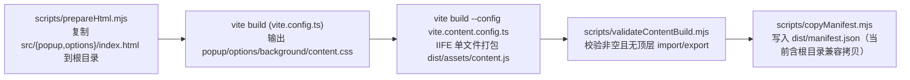

# 系统架构设计（Architecture）

本文档描述 BiliManager 的模块划分、构建流水线、Content Script 生命周期、消息协议与本地存储模型，均基于当前仓库源码梳理。

---

## 1. 目录结构与模块职责

```text
BiliManager/
├── manifest.json                   # MV3 扩展清单（权限仅含 storage + *.bilibili.com host_permissions）
├── scripts/                        # 构建辅助与工程防呆脚本
│   ├── prepareHtml.mjs             # 构建前将 src/{popup,options}/index.html 复制到根目录供 Vite 作为入口
│   ├── validateContentBuild.mjs    # 校验 dist/assets/content.js 非空且不含顶层 import/export
│   ├── copyManifest.mjs            # 拷贝 manifest.json 到 dist/，并（历史兼容）同步产物到项目根目录
│   └── guardBranch.mjs             # 拦截向 master/main 分支直接提交
└── src/
    ├── background/                 # Service Worker（独立后台上下文）
    │   ├── index.ts                # 消息路由、watchTimerWriteQueue 串行写入队列
    │   └── favoriteFolderApi.ts    # B 站收藏夹 API 拉取、内存并发去重与本地缓存
    ├── content/                    # 注入 B 站页面的内容脚本与模块化功能单元
    │   ├── index.ts                # 总控编排：生命周期、URL 轮询、MutationObserver、配置同步
    │   ├── style.css               # Content 总样式入口（带 bm- 前缀的 Tailwind utilities + 各模块 CSS）
    │   ├── searchFilter/           # 搜索页过滤流水线（adapter / ruleEngine / cardPresenter / filterGate）
    │   ├── searchCleanup/          # 搜索页热榜隐藏（html[data-bili-manager-filter-trending]）
    │   ├── blockMenu/              # 视频卡片右下角悬浮“屏蔽”菜单 UI
    │   ├── uploaderBlock/          # 屏蔽 UP 主调用封装
    │   ├── favoriteRecommendation/ # 收藏夹视频池缓存与确定性替换抽样
    │   ├── playerPersonalization/  # 播放页右侧推荐隐藏、广告清理、关闭自动连播、进页关弹幕
    │   ├── playerWatchTimer/       # 播放时长计时状态机、可拖拽浮层视图与会话恢复
    │   ├── playerWatchReminder/    # 连续观看休息提醒定时器、全屏退出与提醒弹窗
    │   ├── customBackground.ts     # 主要 B 站页面的自定义背景图与深浅遮罩注入
    │   ├── pageTheme.ts            # B 站页面深浅色探测
    │   └── pageThemeEvents.ts      # 监听 B 站页面主题切换 DOM/交互事件
    ├── popup/                      # 浏览器工具栏弹窗（360px 看板）
    │   ├── main.tsx                # 预加载设置后挂载 PopupApp
    │   ├── popupApp.tsx            # 全局总开关、正则错误横幅、StatsCard、RecentVideosCard
    │   └── components/             # SegmentedControl、StatsCard、Charts、RecentVideosCard
    ├── options/                    # 扩展完整设置页
    │   ├── main.tsx                # 侧边锚点导航、配置状态编排与所有面板挂载
    │   ├── dataTransfer.ts         # JSON 备份导出/导入（all / settings / watchHistory）与纯文本规则导入
    │   ├── settingsImport.ts       # [已废弃死代码] 早期导入解析器，见 docs/tech-debt.md
    │   ├── utils.ts                # 规则拆分、百分比换算、图片压缩转 JPEG data URL
    │   ├── components/             # Switch、Button、ThemeSwitch、RuleListEditor、Dialog 等控件
    │   └── panels/                 # 7 大设置分区面板
    └── shared/                     # 跨端复用纯逻辑与持久化契约
        ├── types.ts                # 全量设置与运行时状态 TypeScript 类型
        ├── settingsSchema.ts       # 默认配置与 normalizeSettings() 唯一归一化入口
        ├── storage.ts              # ExtensionSettings 读写封装
        ├── uploaderBlocklist.ts    # 已屏蔽 UP 列表读写与匹配规则（mid 优先）
        ├── favoriteFolder.ts       # 收藏夹视频数据结构
        ├── messaging.ts            # ExtensionMessage / ExtensionResponse 联合类型与 sendMessage 封装
        ├── extensionContext.ts     # Extension context invalidated 检测
        ├── watchTimerHistory.ts    # 按日分片索引历史存储、合并、裁剪（370天/5000条）与导出导入
        ├── watchTimerStats.ts      # 近 7 天 / 本月 / 本年统计聚合与环比计算
        ├── useEffectiveDarkTheme.ts# 扩展 UI 深浅主题 Hook
        ├── chromeStorage.ts        # chrome.storage.local 可用性检查
        ├── date.ts / duration.ts / number.ts
```

---

## 2. 双 Vite 构建架构

浏览器扩展的 `content_scripts` 在常规配置下以经典脚本（Classic Script）加载，**不支持顶层 ES Module `import`/`export`**；而 `popup`、`options` 与 `background`（`manifest.json` 中声明 `"type": "module"`）适合使用 ES Module 拆分 chunk。为此仓库采用两阶段 Vite 构建：



- **关键配置细节**：
  - [vite.config.ts](../vite.config.ts) 设置 `modulePreload: false`，避免 Vite 在扩展页面注入 `<link rel="modulepreload">` 导致跨 world 预加载告警。
  - [vite.content.config.ts](../vite.content.config.ts) 设置 `emptyOutDir: false`、`copyPublicDir: false`、`formats: ["iife"]`、`name: "BiliManagerContent"`，在不清空第一阶段产物的前提下追加输出 `dist/assets/content.js`。
  - **Tailwind 隔离**：Popup/Options 使用 [tailwind.config.ts](../tailwind.config.ts)；Content 样式通过 `@config "../../tailwind.content.config.ts"` 启用 `prefix: "bm-"` 且仅输出 `@tailwind utilities`，防止与 B 站自身 CSS 冲突。
  - **加载产物约定**：目标约定统一加载 **`dist/`** 作为已解压扩展目录（根目录同步拷贝的历史遗留记入 [docs/tech-debt.md](./tech-debt.md)）。

---

## 3. Content Script 生命周期与调度（`src/content/index.ts`）

Content 脚本通过 `boot()` 自举，采用**“单次全量扫描 + 竞态代数保护 + 多事件源触发”**的编排模式：

1. **启动与监听绑定**：
   - 注册全局 `unhandledrejection` 监听，捕获 `Extension context invalidated` 后调用 `invalidateExtensionContext()` 彻底摘除所有定时器与 `MutationObserver`，避免扩展热更新后在旧标签页持续报错。
   - 绑定 `chrome.runtime.onMessage` 与 `chrome.storage.onChanged`（监听 `biliFilter.settings` 与 `biliFilter.uploaderBlocklist`）。
   - 执行首次 `scanCurrentPage()`，随后向 Background 发送 `BILI_FILTER_HELLO` 握手。
2. **竞态与重绘保护**：
   - `scanCurrentPage()` 每次执行都会递增 `scanRequest` 并捕获当前 `scanGeneration`；在读取设置（`await getContentSettings()`）和异步拉取收藏夹推荐池（`await loadFavoriteRecommendationPool()`）之后均校验 `generation === scanGeneration && request === scanRequest`，过期异步结果直接丢弃。
   - `scheduleScan(delay)` 先防抖（搜索页默认 `150ms`、播放页 `80ms`、配置/URL/主题变化 `0ms`），再通过 `requestAnimationFrame` 合并同帧重绘。
3. **页面变化感知策略**：
   - **搜索页**：对 `document.body` 开启 `{ childList: true, subtree: true }` 的 `MutationObserver`。
   - **播放页**：优先仅监听 `getPlayerObservationTargets()` 返回的局部容器（`.right-container`、`.bpx-player-container` 等，去除嵌套重复节点），找不到时回退到 `document.body`。
   - **SPA 路由切换**：通过 `setInterval(..., 500)` 轮询 `location.href` 变化，切换后重建 `MutationObserver` 并触发即时扫描。
   - **B 站主题联动**：`pageThemeEvents.ts` 监听页面点击、键盘确认及根元素主题属性变更（延时 `80ms / 260ms / 520ms` 重扫），同步遮罩与背景蒙版明暗。

---

## 4. Runtime 消息协议（`src/shared/messaging.ts`）

所有扩展内部通信统一使用判别联合类型 `ExtensionMessage` 与 `ExtensionResponse`，通过 `sendMessage()` 封装 `chrome.runtime.sendMessage` 与 `lastError` 转换：

| 消息 `type`                           | 发送方                        | 接收方               | 载荷 `payload`             | 用途与响应                                             |
| :------------------------------------ | :---------------------------- | :------------------- | :------------------------- | :----------------------------------------------------- |
| `BILI_FILTER_HELLO`                   | Content                       | Background           | `RuntimeSnapshot`          | 页面握手日志记录；返回基础 `ok`                        |
| `BILI_FILTER_GET_STATUS`              | _(当前无调用方)_              | Background           | —                          | 历史健康检查占位，待清理                               |
| `BILI_FILTER_GET_PAGE_STATUS`         | Popup                         | Content (Active Tab) | —                          | 触发当前页重扫并返回 `snapshot` + `SearchFilterStats`  |
| `BILI_FILTER_SETTINGS_UPDATED`        | Popup                         | Content / Background | —                          | Popup 切换总开关后通知活动页立即重扫并返回统计         |
| `BILI_FILTER_GET_FAVORITE_VIDEOS`     | Content                       | Background           | `{ folderId }`             | 读取收藏夹（优先命中 Background 存储缓存，否则调 API） |
| `BILI_FILTER_REFRESH_FAVORITE_VIDEOS` | Options                       | Background           | `{ folderId }`             | 强制跳过缓存，从 B 站 API 刷新收藏夹列表               |
| `BILI_FILTER_SAVE_WATCH_SESSION`      | Content (`watchTimerHistory`) | Background           | `WatchTimerSessionStorage` | 经写队列持久化单条播放会话并更新日总计/索引/最近列表   |
| `BILI_FILTER_REPLACE_WATCH_HISTORY`   | Options (`dataTransfer`)      | Background           | `WatchTimerHistoryBackup`  | 经写队列清空并导入全量历史备份，随后执行裁剪           |
| `BILI_FILTER_PRUNE_WATCH_HISTORY`     | Content (`watchTimerHistory`) | Background           | `{ todayKey }`             | 经写队列裁剪超过 370 天或超出 5000 条上限的历史记录    |

---

## 5. 本地存储模型（`chrome.storage.local`）

所有数据均存储在 `chrome.storage.local`，禁用 `chrome.storage.sync`。

| Storage Key / 前缀                                                       | 写入方                             | 内容摘要                                                          | 清理/过期策略                              |
| :----------------------------------------------------------------------- | :--------------------------------- | :---------------------------------------------------------------- | :----------------------------------------- |
| `biliFilter.settings`                                                    | Popup / Options / WatchTimer(关闭) | `ExtensionSettings` 全量配置（含压缩后自定义背景 JPEG data URL）  | 持久化，随设置保存更新                     |
| `biliFilter.uploaderBlocklist`                                           | Content (`blockMenu`) / Options    | `BlockedUploader[]`（`id`, `mid`, `name`, `addedAt`）             | 持久化                                     |
| `biliFilter.favoriteFolderCache`                                         | Background (`favoriteFolderApi`)   | `{ [folderId]: { version: 3, result, cachedAt } }` 收藏夹视频缓存 | 手动刷新覆盖；Content 侧另有 5min 内存缓存 |
| `biliManager.playerWatchTimer`                                           | Content (`playerWatchTimer`)       | `{ left, top }` 浮层拖拽坐标                                      | 持久化                                     |
| `biliManager.playerWatchTimerActiveSession`                              | Content (`playerWatchTimer`)       | 当前播放页断点续传状态（总时长/今日时长及前后台拆分）             | 读取时超过 **12 小时** 自动失效            |
| `biliManager.watchReminder.session`                                      | Content (`playerWatchReminder`)    | `{ accumulatedMs, lastPlaybackAt, updatedAt }` 连续观看累计       | 停止播放超过设定中断间隔自动清零           |
| `biliManager.watchTimer.dateIndex`                                       | Background                         | 已有记录的本地日期键（`YYYY-MM-DD`）有序列表                      | 裁剪时同步移除过期日期                     |
| `biliManager.watchTimer.recentVideos`                                    | Background                         | 最近观看视频列表                                                  | 按 `updatedAt` 倒序，最多保留 **100** 条   |
| `biliManager.watchTimer.dailyTotal:{dateKey}`                            | Background                         | 当日总计 / 前台 / 后台毫秒数                                      | 随历史裁剪移除                             |
| `biliManager.watchTimer.session:{dateKey}:{id}`                          | Background                         | 单次会话明细（仅保存 `> 3000ms` 的会话）                          | 最长保留 **370 天**                        |
| `biliManager.watchTimer.video:{dateKey}:{pageKey}`                       | Background                         | 当日观看过的视频元数据（标题、URL、更新时间）                     | 全局索引总量上限 **5000** 条               |
| `biliManager.watchTimer.sessionIndex:{dateKey}` / `videoIndex:{dateKey}` | Background                         | 某日对应的 session/video key 列表，便于按日批量加载与清理         | 随对应日期一同裁剪                         |

---

## 6. 核心子系统内部设计

### 6.1 搜索结果过滤与收藏夹置换流水线

1. **DOM 采集（`pageAdapter.ts`）**：扫描搜索页视频卡片，提取标题、高亮状态、UP 主名与 `mid`、课程标记、播放量与弹幕数（支持 `万`/`亿` 中文单位解析及 `.bili-video-card__stats--item` 顺序回退）。
2. **规则评估（`ruleEngine.ts` + `searchFilter/index.ts`）**：预编译标题与 UP 正则并收集语法错误（透传给 Popup 展示），依次判定正则、课程标签、未命中搜索词、播放量下限、弹幕/播放互动率以及 UP 主屏蔽列表。
3. **呈现与门控（`cardPresenter.ts` + `filterGate.ts`）**：
   - 若命中规则且开启 `strictInterception`：创建 HTML Comment 占位节点替换卡片布局根元素（存入 `strictlyRemovedCards` Map），规则变更或切页时可原地恢复。
   - 若命中规则且非严格拦截：按 `favoriteRecommendation` 配置从收藏夹视频池抽样——使用 **FNV-1a 32 位哈希** 对卡片稳定标识分别计算抽样概率与视频索引（排除原卡片自身 BV 号），保证同一页同一卡片在 DOM 重扫时替换结果稳定不闪烁；随后通过 `filterGate.ts` 绑定文档捕获阶段事件实现三态右键解锁。
   - 未命中规则但开启了对应的仅黑白降权选项：添加 `bili-manager-unhighlighted-title` 与 `bili-manager-grayscale-cover`。

### 6.2 观看时长统计与跨标签页并发安全

- **状态机（`playerWatchTimer/state.ts`）**：以 `countingMode`（`"foreground"` | `"background"` | `null`）为核心驱动。每当播放态、可见性、日期跨天或切换视频时，先 `commit()` 结算上一状态区间增量，再切换状态，确保前/后台时长精确互斥累加且 `foregroundElapsedMs + backgroundElapsedMs === elapsedMs`。
- **写队列串行化（`background/index.ts`）**：多个 B 站播放页同时写入时，Content 侧通过消息把会话发往 Background，由 `watchTimerWriteQueue` 链式串行执行 `chrome.storage.local` 的读取-增量累加-索引更新，防止多标签页并发写入覆盖 `dailyTotal` 或索引列表。
